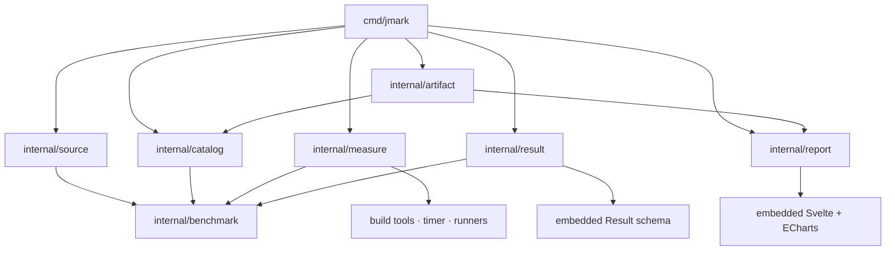

# Architecture

jmark runs equivalent workloads across registered runtimes and produces standalone
comparison reports. The command-line host discovers configuration, prepares an
execution plan, measures child processes, validates results, and publishes local
artifacts. The report UI uses Svelte and ECharts.

[README.md](README.md) covers commands and setup. [AGENTS.md](AGENTS.md) defines
benchmark source rules. [DESIGN.md](DESIGN.md) defines report presentation and
interaction.

## Domain model

A **project** defines the workload, input size, iteration counts, and implementations
to compare. An **approach** is one implementation of that workload. Each source
family in a project provides the same set of approach names.

A **family** supplies an input factory, approach sources, a shared runner, templates,
and source validation rules. A **runtime** specifies how to build and execute a
family's sources. Several runtimes can share a family without duplicating benchmark
logic. Registry files determine runtime discovery, tool requirements, commands,
version capture, and probe availability.

The runner creates one input, calls the selected approach repeatedly, and accumulates
its numeric return value into a sink. Approach sources contain the algorithm only.
Measurement, warmup counts, output protocols, and optional instrumentation belong
to the host and runner.

## Directory structure

```text
jmark/
├── AGENTS.md                         Benchmark authoring rules
├── ARCHITECTURE.md                   Components, contracts, and execution model
├── DESIGN.md                        Report design and interaction standards
├── README.md                        Usage and development guide
├── .github/workflows/pages.yml      Public result build and GitHub Pages deployment
├── justfile                         CLI and frontend build recipes
├── go.mod                           Host toolchain and dependency declarations
├── go.sum                           Dependency checksums
├── cmd/jmark/                       CLI composition and terminal interactions
│   ├── main.go                      Root discovery and command dispatch
│   ├── bench.go                     Benchmark orchestration and output selection
│   ├── doctor.go                    Tool, registry, project, and probe checks
│   ├── tui.go                       Run selection, browser opening, deletion
│   └── *_test.go                    CLI behavior and terminal flow tests
├── internal/
│   ├── benchmark/                   Shared Plan, Sample, and Measurement types
│   ├── catalog/                     Registry, workload parsing, validation, scaffolding
│   ├── measure/                     Workspaces, builds, external timing, probes, host data
│   ├── result/                      Unit conversion, sink agreement, schema validation
│   │   └── testdata/golden/          Timing and probe conversion fixtures
│   ├── source/                      Execution source snapshots and Markdown export
│   ├── artifact/                    Saved-run visibility, publication, and static site build
│   └── report/                      Result projection and standalone HTML rendering
│       ├── page.html                Shared report shell
│       ├── testdata/                Environment projection fixtures
│       └── ui/
│           ├── src/                 Components, chart model, styles, and model tests
│           ├── build.mjs            Component compilation and asset manifest generation
│           ├── package.json         Frontend dependencies and commands
│           ├── package-lock.json    Locked frontend dependency tree
│           └── dist/                Embedded assets and their build manifest
├── benches/<project>/
│   ├── AGENTS.md                    Strategy, at most 200 Unicode characters
│   ├── bench.toml                   Input size, warmup, iterations, runs, probes
│   └── <family>/                    Input factory and one source file per approach
├── runtimes/<runtime>.toml          Execution configuration for a source family
├── mise.toml / mise.lock            Runtime versions and mise-managed downloads
├── families/<family>/
│   ├── runner.<ext>                 Repeated invocation and sink output
│   ├── forbid.re                    Source patterns rejected by validation
│   ├── template/                    Input and approach scaffolding
│   └── probes/                      Optional hooks and null workload for bias checks
├── schema/
│   ├── result.schema.json           Persisted Result contract
│   └── schema.go                    Embeds the contract in the host binary
├── .cursor/skills/verify-jmark/      CLI verification procedures and evidence
├── artifacts/
│   ├── private/                     Default saved results; ignored by Git
│   └── public/                      Explicitly shared results; versioned by Git
├── .jmark/
│   ├── build/                       Execution workspaces; ignored by Git
│   └── site/                        Generated public website; ignored by Git
└── .audit/                          Optional local inspection files; ignored by Git
```

Directory names in angle brackets represent registry identifiers. The `probes/`
directory is optional. Generated frontend assets and their manifest are versioned
with their sources; installed frontend dependencies are ignored.

## Component boundaries



| Component | Responsibility | Boundary |
| --- | --- | --- |
| `benchmark` | Shared execution and observation types | No filesystem or process operations |
| `catalog` | Parse and validate configuration; assemble plans; create source scaffolds | Reads registry and project files; does not execute workloads |
| `measure` | Bind workspaces, build approaches, run timing and probe passes | Owns child processes and temporary execution files |
| `result` | Convert observations into metrics and validate output | Does not discover runtimes, launch processes, or write artifacts |
| `source` | Capture execution files, verify unchanged contents, export Markdown | Reads files named by a Plan and its configuration |
| `artifact` | Stage complete runs, change visibility, generate the public site | Owns saved-run publication and public-only site output |
| `report` | Normalize saved results, project UI rows and environment metadata, render HTML | Does not measure workloads or publish artifact directories |
| `cmd/jmark` | Coordinate components, select output modes, handle terminal actions | Owns user-facing orchestration and error reporting |

Plans and observations cross package boundaries as shared types. Their serialization
is unnecessary during execution. JSON is used for persisted results, frontend data,
and the external timer protocol. TSV remains the probe process protocol and a
fixture format for conversion tests.

## Planning and execution

`bench` validates the project and registry, selects runtimes, and captures the host
snapshot. Explicit selection of an unavailable runtime fails. An unrestricted run
warns and skips unavailable entries.

For each selected runtime, the catalog produces a `benchmark.Plan` containing
workload parameters, source locations, commands, approach names, and selected
probes. The catalog expands source and input placeholders. Build-directory and
iteration placeholders remain unresolved until execution.

`Measure.Run` owns one complete execution:

1. Validate iteration counts and allocate `.jmark/build/run-<suffix>/`.
2. Copy the plan's approach entries and bind their build paths to that directory.
3. Build the approaches.
4. Collect timing medians and verify sink proportionality.
5. Run optional probes against the same build products.
6. Return a `benchmark.Measurement` and remove the workspace.

Build, timing, and probe failures release the workspace. Probe self-tests use the
same preparation and cleanup mechanism. Concurrent executions receive distinct
build directories, and binding does not mutate the caller's plan. Filesystem
isolation does not prevent concurrent workloads from competing for machine
resources and affecting measurements.

Runtime version capture executes the registry's optional `version` command. Its
default is the first `needs` command followed by `--version`. The first output line
is retained; a failed command fails the benchmark. The measurement package does not
select behavior by runtime identifier.

Runtime installation and locking are delegated to mise. The CLI forwards
`runtimes lock` and `runtimes install` to mise. Before running a benchmark,
the CLI invokes itself through `mise exec --locked` with a fresh data directory.
The child host measures runtimes directly; mise startup and installation are
outside measurement. The parent removes temporary installations after exit.
`scripts/mise` invokes mise from `PATH` and keeps downloads in `.jmark/`.

Runtimes and approaches are measured sequentially within a CLI invocation. Results
are buffered until every selected runtime succeeds. A measurement or validation
failure emits no Result lines and publishes no saved run. Progress and warnings go
to stderr. A failure while writing stdout can still leave a partially written stream.

Run and version commands use space-separated arguments without a shell. Build
commands run through a shell. Repository paths containing whitespace are rejected;
command templates do not provide general argument quoting for timed execution.

## Measurement semantics

The external timer measures the runner process, including startup, module loading,
and input generation. For workload warmup count `W` and measured iteration count
`N`, jmark calculates:

```text
lo = median(T(W))                 seconds
hi = median(T(W + N))             seconds
delta = hi - lo
value = delta / N × 1,000,000     µs/op
total_ms = delta × 1,000          ms
```

An operation is one approach call over the complete input. The `runs` parameter
controls the number of process samples. The timer also performs one process-level
warmup. The workload's `warmup` is the baseline loop count used for subtraction.

The difference estimates the incremental cost of `N` calls. A nonpositive difference
fails with a noise-floor error. Independent medians do not provide an uncertainty
estimate; raw timing distributions, confidence intervals, and error bars are not
stored or displayed.

Sink proportionality checks whether repeated calls preserve the expected work.
Result conversion requires approach sinks to agree within each runtime and preserves
numeric sink precision. Cross-runtime disagreement produces a warning. These checks
do not constitute a general proof of algorithmic equivalence.

Probes execute separately from timing. Their baseline and workload counter medians
are subtracted and divided by `N`, with values stored in `meta.probes`. Probe
self-tests use a null workload and reject absolute changes above `0.001` per operation.
Probe counters are retained in saved results but are not projected into the report UI.

## Result contract and storage

A Result contains `project`, `runtime`, `metric`, `results`, and `meta`. The metric
is `us_per_op`; each approach result includes its name, value, iteration count,
sink, and total milliseconds. Metadata includes workload parameters, measurement
method, capture time, host information, and runtime version.

The top-level `runtime` is the registry identifier. `meta.runtime` is the version
string. Report projection exposes these as `runtime` and `runtime_version`.
The report reader normalizes the legacy top-level `lang` field when `runtime` is
absent. Saved files are not rewritten during reading.

[The Result schema](schema/result.schema.json) is embedded and compiled once by
`internal/result`. Validation uses this contract directly, including restrictions
on additional fields. Values are normalized as JSON without converting all numbers
to floating point. Non-JSON numeric values are rejected before validation.

| Output mode | Saved files | stdout |
| --- | --- | --- |
| `stream` | None | One Result JSON object per line |
| `ndjson` | `result.ndjson`, `env.json`, `sources.md` | Relative result path |
| `html` | Both files above and `report.html` | Relative report path |

Saved runs default to `artifacts/private/<project>/<timestamp>-<suffix>/`. Directory
timestamps use local time; `meta.captured_at` uses UTC. `env.json` summarizes the
capture time, host, and runtime versions.

The artifact package prepares output content before creating a staging directory.
It writes all files under `artifacts/private/<project>/.pending-<timestamp>-<suffix>/` and
renames that directory after successful completion. Staging and publication occur
within the same parent filesystem. The run picker ignores hidden directories.
Ordinary write failures remove staged files; abrupt process termination can leave
hidden staging directories. Publication provides directory-level visibility, not
a guarantee that data has been flushed to durable storage after a power failure.

`public` and `private` move complete run directories between visibility roots.
The Git ignore rules exclude private storage and temporary staging directories while
allowing public results. Visibility changes do not modify the Git index or commit
history. Run discovery and movement reject symbolic run directories and invalid
path components; moves fail when their destination already exists.

Saved runs include a `sources.md` snapshot. Before measurement, the host reads the
input factory, runner, approaches, selected probe hooks, workload configuration,
and runtime configuration referenced by the plan. It checks captured files after
each runtime completes and rejects changed contents. A shared file must have the
same contents across runtime snapshots. This does not capture installed toolchains,
external dependencies, or arbitrary transitive imports.

## Public website

`site` generates `.jmark/site/` using only `artifacts/public/`. It builds the complete
output in a temporary directory before replacing the previous generated site.
Rebuilding removes reports for runs that are no longer public. Private results are
not read or copied into this output.

The site contains `index.html`, `.nojekyll`, and `<project>/<run>/report.html` pages
with their result data and available source snapshots. Reports are regenerated
from saved NDJSON using the current embedded UI. Their `←` navigation uses
`../../index.html`, so links work under a repository URL prefix or a custom domain.
The index supports searching project names, runtimes, and run identifiers.

The GitHub Actions workflow watches public results and host/report sources, builds
on the repository's default branch, uploads only `.jmark/site`, and deploys through
the `github-pages` environment. GitHub Pages uses **GitHub Actions** as its publishing
source. Site generation does not execute benchmark workloads.

## Reports and saved-run interactions

`open` discovers published result files, selects runs through the terminal picker,
and renders them using the currently embedded UI. It writes a temporary comparison
HTML file and opens it in the browser. Existing saved `report.html` files remain
unchanged. The temporary comparison file remains available after CLI exit.

`delete` and the delete action in the picker validate selected paths and request
confirmation before removing run directories.

Single-run and comparison reports share the same frontend. One chart compares
values on a shared numeric axis. Approach, Runtime, and Run can define categories
and series. Linear scale uses zero-based bars; logarithmic scale uses points and
requires positive values. Duplicate observations remain separate.

Workloads are separated by project, metric, input size, warmup, iteration count, and
sample count. Host and runtime version are displayed but do not partition workloads.
Source snapshots accompany newly saved runs; their contents do not partition the
chart. Comparisons preserve observations without asserting identical environments
or implementation contents. UI state remains in component memory.

Reports render stored source Markdown with syntax highlighting and provide a
Markdown download. Raw HTML in Markdown is disabled and code text is escaped.
Historical runs without snapshots retain an explicit unavailable state.

Reports embed their code, styles, and data in one HTML document. Title text and
embedded JSON are escaped before insertion. Browsers need no server or network
connection to display a report.

## Build and verification

CLI recipes run the host directly from source. The host toolchain version is declared
in `go.mod`. `just ui-build` installs locked frontend dependencies, checks components,
runs model tests, and builds the embedded assets.

The frontend build records SHA-256 hashes of source files, build configuration,
dependency declarations, and generated assets in `ui/dist/manifest.json`. Host tests
verify the file set and hashes. Changed, added, or removed inputs require a new
frontend build. `bench` and `open` use embedded assets without rebuilding them or
checking the manifest during execution.

| Verification | Coverage |
| --- | --- |
| `go test ./...` | Catalog rules, CLI fixtures, execution isolation, cleanup, result conversion, schema validation, artifact publication, report data, asset freshness |
| `go test -race ./...` | Concurrent access checks, including shared-plan execution |
| `go test -tags live ./internal/measure` | Process integration using installed timer and runtime tools |
| `just doctor` | Installed host tools, registry, project layouts, runtime availability, probe bias checks |
| Frontend `check` and `test` scripts | Component diagnostics and chart data behavior |
| `.cursor/skills/verify-jmark/` | Real CLI commands with retained stdout, stderr, and exit codes |

Default tests use repository fixtures and temporary files. They do not depend on
local audit baselines or installed benchmark runtimes. Process fixtures use the
host shell and standard file utilities. Live tests are enabled explicitly and
require their external tools. Browser interactions are verified manually; the
repository does not contain an automated browser interaction suite.

## Extension points

| Component added or changed | Location |
| --- | --- |
| Benchmark or approach | `benches/<project>/` with matching approach names across families |
| Runtime | `runtimes/<runtime>.toml` |
| Source family | `families/<family>/`, project sources, and runtime registry entries |
| Probe | `families/<family>/probes/`, runtime capabilities, workload selection |
| Measurement method | `internal/measure/`; shared observations in `internal/benchmark/` |
| Persisted metric or metadata | `internal/result/` and `schema/result.schema.json` |
| Artifact visibility and public site generation | `internal/artifact/` |
| Source capture and Markdown export | `internal/source/` |
| CLI and terminal actions | `cmd/jmark/` |
| Report data projection | `internal/report/` |
| Chart and interaction behavior | `internal/report/ui/src/`, followed by a frontend build |
